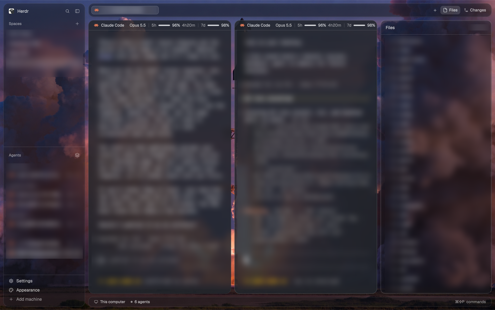

# Herdr Starship

A dark frosted-glass layout for the [Herdr](https://herdr.dev) desktop app, set over a
photo of SpaceX's Starship rolling out to Starbase. Every Claude Code pane shows the
session's model and how much of your 5-hour and 7-day plan limits is left, with the time
until each one resets.



Version 0.1.0, built on herdr-app 0.1.16. Based on
[Herdr Glass](https://github.com/noah4520/herdr-glass) by Noah Chen. See
[CHANGELOG.md](CHANGELOG.md) for what changed in each version.

## Features

- **Starship background.** The layout opens on the Starship photo, under translucent
  rounded cards for the sidebar, tab bar, side panel and status bar.
- **Plan usage in every Claude Code pane header:**

  ```
  Claude Code  ~/project              Opus 5.5 │ 5h ▬▬▬ 95% 4h14m │ 7d ▬▬▬ 85% 1d9h
  ```

  Each bar shows the share of that limit you have *left*. It turns yellow at 30% and
  red at 10%. The time after it counts down to the reset. This needs one line in your
  Claude Code settings; see [Usage meters](#usage-meters).
- **MesloLGM Nerd Font Mono included.** The terminals use it without you installing
  anything.
- **Appearance** (in the sidebar footer). Every click applies at once:
  - **Glass**: Clear, Light, Medium, Tinted or Solid. Use a more solid level over
    brighter pictures.
  - **Image**: choose the background. Default is the Starship photo. **Open folder** opens
    `~/.config/herdr-app/backgrounds/`; add or delete pictures there. Graphite, Sunset,
    Ocean, Forest, Violet, Rose and Aurora are copied into it the first time you open
    the dialog.
  - **Components**: **Starship** uses the restyled Spaces, Agents, pane headers and
    notifications. **Herdr** switches back to Herdr's own versions, which update with
    Herdr.
- **Agents grouped by space**, and notifications with a colour bar for each level
  (from Herdr Glass).

## Install

Ask your agent, from a terminal in Herdr:

```
Read ~/.config/herdr-app/AGENTS.md, then add this layout: https://github.com/matthewishandsome/herdr-starship
```

The agent reads every file before it adds the layout, its theme and its mods. Or install
it yourself:

```sh
git clone https://github.com/matthewishandsome/herdr-starship.git
cd herdr-starship
./scripts/install.sh
herdr-app do layout.switch '{"name":"herdr-starship"}'
```

Then **quit and reopen Herdr once**. Herdr loads the bundled font only when it starts.

The installer copies the layout, theme and mods into `~/.config/herdr-app` and checks
each mod. It never touches Herdr's own layouts and mods. If any Herdr Starship file is
already there, it stops instead of overwriting it. Your current layout doesn't change;
press `ctrl-shift-l` to switch between layouts.

**Requirements**

- The Herdr app, opened at least once. Herdr Starship is built and tested on herdr-app
  0.1.16 on macOS. Linux should work but is untested. Windows isn't supported, because
  Appearance runs `sh`.
- For the usage meters: Claude Code on a Claude subscription (Pro, Max, Team or
  Enterprise), and `jq`. API-key, Bedrock and Vertex sessions have no plan limits, so
  their headers show only the model.

## Usage meters

Claude Code passes its plan limits to a
[status line](https://docs.claude.com/en/docs/claude-code/statusline) command. Herdr
Starship includes a small one that saves them to a file, which the pane header reads.

1. Copy the script:

   ```sh
   cp extras/claude-statusline.sh ~/.claude/herdr-statusline.sh
   chmod +x ~/.claude/herdr-statusline.sh
   ```

2. Add this to `~/.claude/settings.json`:

   ```json
   "statusLine": {
     "type": "command",
     "command": "~/.claude/herdr-statusline.sh",
     "padding": 0
   }
   ```

The script prints nothing, so Claude Code's own screen looks the same as before. It runs
only inside Herdr terminals, and it writes only to
`~/.local/state/herdr-usage/<terminal>.json`.

**If you already have a status line:** Claude Code runs only one command. Instead of
replacing yours, add this at the top of your script so it saves the file as well:

```sh
input=$(cat); printf '%s' "$input" | ~/.claude/herdr-statusline.sh
```

Then have the rest of your script read `$input` instead of stdin.

**Good to know:**
- The numbers update when Claude Code redraws its status line, for example after each
  reply. The reset countdown moves every minute on its own.
- The limits are per account, so every Claude pane shows the same percentages. Only the
  model name is per session.
- Only Claude Code reports these limits. Other agents' panes show no meters.

## Update and remove

To update, pull and install over the old files:

```sh
git pull
./scripts/install.sh --force
```

`--force` also replaces the layout file, so your Appearance choices (glass level,
background, components) go back to the defaults. Pictures in `backgrounds/` are kept.

To remove Herdr Starship, switch to another layout (`ctrl-shift-l`) and delete its files:

```sh
cd ~/.config/herdr-app
rm -r layouts/herdr-starship.json layouts/herdr-starship.svg themes/herdr-starship.json \
  mods/herdr-starship-tabs mods/herdr-starship-chrome mods/herdr-starship-spaces \
  mods/herdr-starship-agents mods/herdr-starship-status mods/herdr-starship-pane \
  mods/herdr-starship-toast mods/herdr-starship-bg
```

If you set up the usage meters, also remove the `statusLine` entry from
`~/.claude/settings.json`, and delete `~/.claude/herdr-statusline.sh` and
`~/.local/state/herdr-usage/`.

## What it runs and stores

- **Appearance** (`mods/herdr-starship-bg`) lists `~/.config/herdr-app/backgrounds/`,
  copies the preset pictures into it once, and opens it in the file manager. It saves
  your choices to the file of the layout on screen (`layouts/<name>.json`), and refuses
  to change Herdr's own layouts.
- **Pane header** (`mods/herdr-starship-pane`) reads
  `~/.local/state/herdr-usage/<terminal>.json`.
- **`extras/claude-statusline.sh`** writes that file. It runs only if you hook it up
  yourself.
- The other mods are copies of Herdr's own and behave like them. For example, the spaces
  list runs `git` to show branch names and `hc` to list your other machines.
- Herdr Starship makes no network requests of its own.

## What's inside

| Path | What it is |
|---|---|
| `layouts/herdr-starship.json` | The layout, from Herdr's `main` |
| `layouts/herdr-starship.svg` | Its picture in Herdr's settings |
| `themes/herdr-starship.json` | The layout's theme (Ghostty's default colours) |
| `mods/herdr-starship-pane` | Pane header with the usage meters |
| `mods/herdr-starship-bg` | The Appearance dialog, the background pictures and the bundled font |
| `mods/herdr-starship-tabs` | Tab bar without its bottom line |
| `mods/herdr-starship-chrome` | Top and footer rows of the sidebar: fold button, Appearance entry |
| `mods/herdr-starship-spaces` | Spaces list without the letter avatars |
| `mods/herdr-starship-agents` | Agents list, grouped by space |
| `mods/herdr-starship-status` | Status bar without its top line |
| `mods/herdr-starship-toast` | Notifications with a colour bar and the agent's title |
| `extras/claude-statusline.sh` | Claude Code status line command that feeds the usage meters |
| `RECIPE.md` | Instructions an agent can use to install or rebuild Herdr Starship |

The seven mods other than `herdr-starship-bg` are copies of Herdr's own 0.1.16 mods with
small changes, so they don't follow Herdr updates.

## Credits and licenses

- Layout, Appearance dialog, theme and preset pictures: based on
  [Herdr Glass](https://github.com/noah4520/herdr-glass) by Noah Chen, MIT.
- Herdr Starship's own changes: [MIT](LICENSE).
- The layout file and the cloned mods come from the
  [Herdr app](https://github.com/herdrdev/herdr-app), Apache-2.0
  ([licenses/Herdr-Apache-2.0.txt](licenses/Herdr-Apache-2.0.txt)). [NOTICE](NOTICE) lists
  them and what changed.
- Icons: [Lucide](https://lucide.dev), ISC ([licenses/Lucide-ISC.txt](licenses/Lucide-ISC.txt)).
- Font: MesloLGM Nerd Font Mono. Meslo LG is by André Berg, Apache-2.0
  ([licenses/MesloLGM-Nerd-Font-LICENSE.txt](licenses/MesloLGM-Nerd-Font-LICENSE.txt)).
  The Nerd Fonts patch is by [Ryan L McIntyre](https://github.com/ryanoasis/nerd-fonts).
- **Background photo** (`mods/herdr-starship-bg/presets/starship.jpg`): Starship moving to
  Starbase, as shared in
  [iDownloadBlog's Starship wallpapers](https://www.idownloadblog.com/2025/09/10/starship-wallpapers-iphone/).
  The photographer isn't named there; the page says most of its pictures come from
  SpaceX. **The photo is not covered by this repository's licenses.** All rights stay
  with its owner. If you own it and want it removed, please open an issue and it will
  be taken down.

Herdr Starship is a community layout. It is not affiliated with or endorsed by Herdr or
SpaceX.
